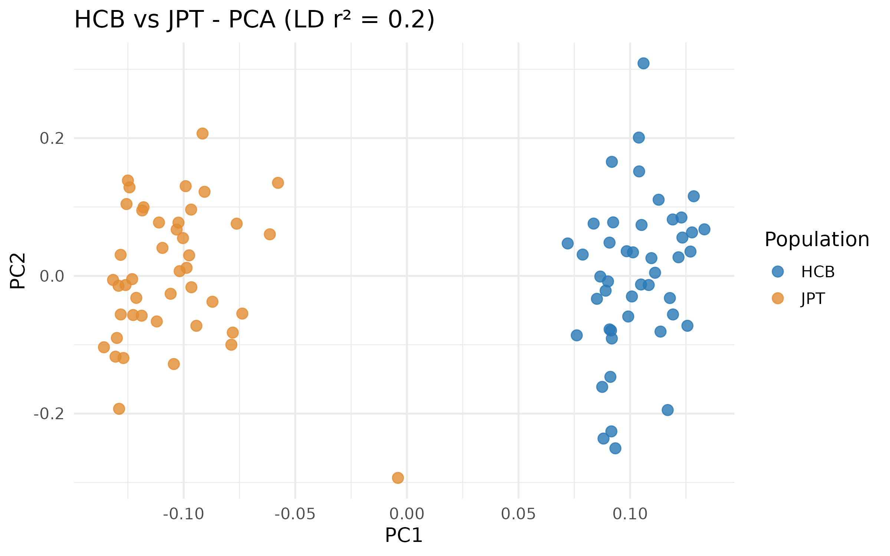
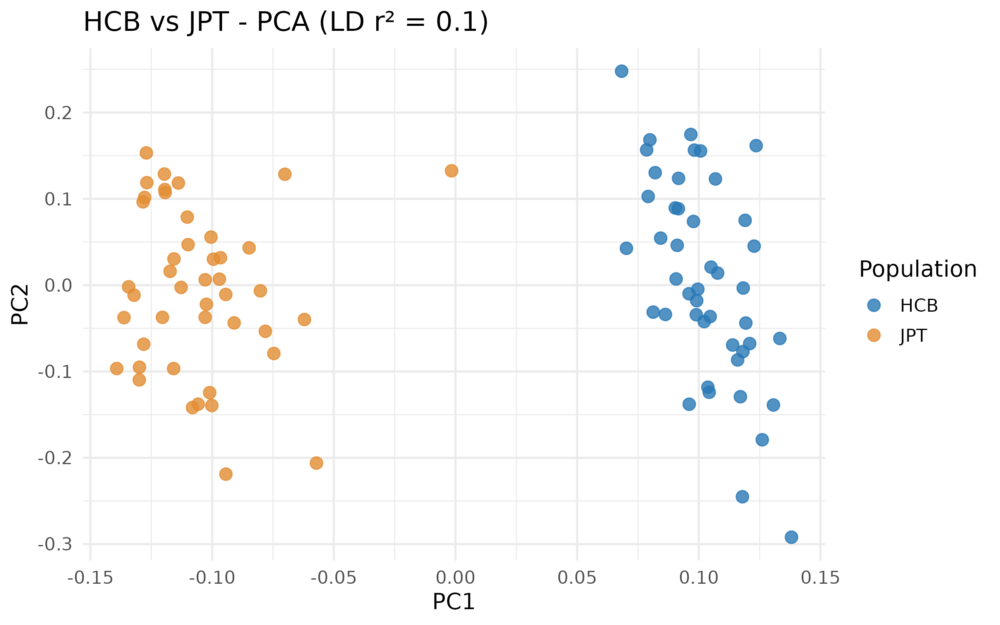
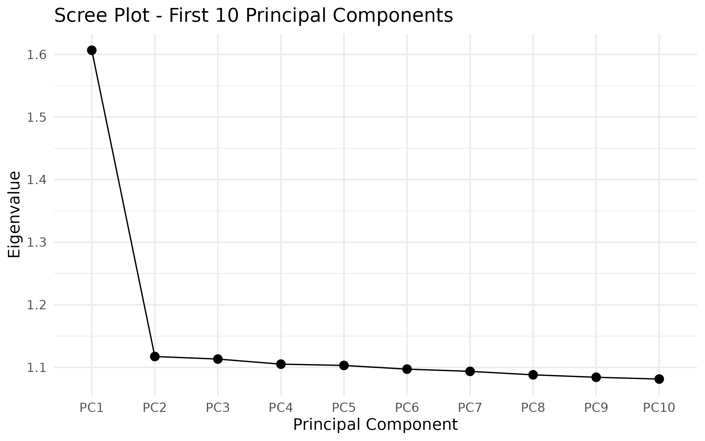

# HapMap Population Structure Analysis: HCB vs JPT

An educational and reproducible population-genomics project investigating genetic differentiation between Han Chinese in Beijing (HCB) and Japanese in Tokyo (JPT) samples using PLINK 2.0 and R.

## Research Question

Can genome-wide SNP variation reveal genetic differentiation and population structure between HCB and JPT samples?

## Dataset

Source: [PLINK HapMap tutorial](https://zzz.nyspi.org/plink/tutorial.shtml)

| Property | Value |
|---|---:|
| Individuals | 89 |
| HCB samples | 45 |
| JPT samples | 44 |
| Initial variants | 83,534 |

The dataset uses a legacy PED/MAP format and includes population metadata in `pop.phe`.

Input data are not distributed in this repository. Download the tutorial dataset and place `hapmap1.ped`, `hapmap1.map`, and `pop.phe` inside the `data/` directory.

## Analysis Workflow

```text
Raw HapMap PED/MAP
        |
        v
PLINK2 conversion
        |
        v
Variant missingness QC (5%)
        | 81,400 variants
        v
MAF filtering (5%)
        | 57,689 variants
        v
    +-------------------+
    |                   |
    v                   v
Hudson's FST       LD pruning
                        |
                 +------+------+
                 |             |
                 v             v
              r² = 0.2      r² = 0.1
              31,822        22,830
                 |             |
                 v             v
               PCA           PCA
                 |             |
                 +------+------+
                        |
                        v
                  R + ggplot2
                        |
                        v
                Scientific figures
```

## Requirements

The workflow requires a Bash-compatible Linux environment, PLINK 2.0, R, and the R package `ggplot2`.

The analysis was developed using PLINK 2.0 (build `2.0.0-b.1.4`, November 7, 2026). Other software versions should be documented when reproducing the analysis.

## Reproduction

From the project root directory, activate an environment containing PLINK 2.0 and ensure `Rscript` and `ggplot2` are available.

Run:

```bash
bash scripts/run_all.sh
```

The workflow performs genotype conversion, variant quality control, FST estimation, LD pruning, PCA, and figure generation.

Intermediate outputs are saved under `results/reproduced/`, while the generated figures are saved under `figures/reproduced/`.

## Main Results

| Analysis | Result |
|---|---:|
| Variants after missingness QC | 81,400 |
| Variants after MAF filtering | 57,689 |
| Hudson's FST, before MAF filtering | 0.00682475 |
| Hudson's FST, after MAF filtering | 0.00686778 |
| SNPs retained, LD r² = 0.2 | 31,822 |
| SNPs retained, LD r² = 0.1 | 22,830 |

Hudson's FST indicates low overall genetic differentiation between the sampled populations.

PCA displays visible population-associated separation along PC1 under both LD-pruning configurations.

These observations are exploratory and should not be interpreted as proof of complete genetic separation.

## Figures

**Standard PCA (LD r² = 0.2)**



**Strict PCA (LD r² = 0.1)**



**Scree Plot**



## Scientific Limitations

- The original teaching dataset contains artificial SNP positions, limiting the genomic validity of sliding-window LD pruning.
- The dataset contains a relatively small number of individuals.
- The source data use numerical allele codes and provisional reference-allele assignments.
- The source phenotype and sex fields require careful interpretation and must not be confused with validated population or demographic metadata.
- Statistical uncertainty, sample relatedness, and technical effects were not comprehensively evaluated.
- Reproduction was verified locally, not independently across different computing environments.

## Conclusion

This project demonstrates a reproducible workflow for introductory population-genomics analysis using PLINK 2.0, Bash, and R.

The analysis reveals low genome-wide differentiation alongside visible multivariate population structure. Additional validation using datasets with authentic genomic coordinates is necessary before drawing stronger biological conclusions.

**Project status:** Educational and exploratory. Not a novel population-genetics discovery.